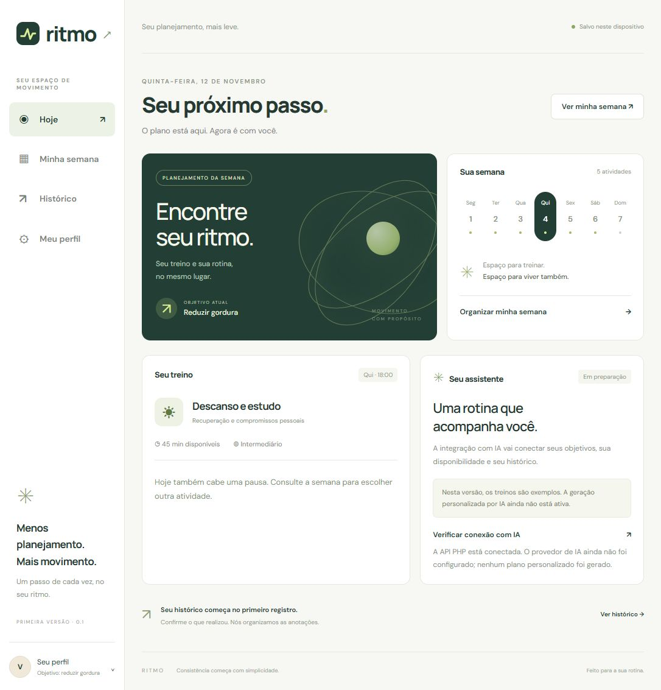

# Ritmo — primeira entrega (0.1)

Aplicação web para organizar treinos e registrar desempenho, com Angular + TypeScript e API em PHP/Laravel. Primeira versão funcional: 0.1.0.



O projeto demonstra planejamento semanal, registro por série e revisão de sessões. A integração real com IA ainda não está ativa.

## Executar neste computador

Instale Node.js 24 com npm, PHP 8.4 e Composer. Antes de iniciar, instale as dependências:

```powershell
cd frontend
npm ci
cd ../backend
composer install
Copy-Item .env.example .env
php artisan key:generate
New-Item -ItemType File -Path database/database.sqlite -Force
php artisan migrate
cd ..
```

Para testar os endpoints privados de persistência, configure `RITMO_OWNER_TOKEN` no arquivo `backend/.env` com um token aleatório de pelo menos 32 caracteres. Não publique esse arquivo. O registro da interface funciona localmente no navegador nesta versão.

Abra dois terminais PowerShell nesta pasta:

```powershell
./start-backend.ps1
```

```powershell
./start-frontend.ps1
```

Acesse http://127.0.0.1:4200. A API responde em http://127.0.0.1:8000/api/health.
Os servidores só escutam neste computador; esse endereço não abre o aplicativo no iPhone.

## O que funciona

- Semana inicial com os compromissos discutidos, editável.
- Seleção da atividade e sessão de demonstração com duração escolhida.
- Sessão curta de musculação com três exercícios de exemplo.
- Carga, repetições e RIR por série; somente valores confirmados entram nos totais.
- Registro durante a execução, revisão final e edição posterior sem duplicar sessões.
- Retomada da sessão após recarregar, histórico local e exportação JSON.
- Perfil com objetivo, experiência, equipamentos e preferência de autonomia.
- Troca manual entre dias e desfazer a última troca.
- Layout responsivo para celular e computador.

## Limites desta entrega

Esta é uma base funcional local, não um serviço pronto para lançamento público. As fichas são demonstrações explícitas, não prescrições por IA. A escolha de duração reduz o exemplo de treino, não calcula uma prescrição personalizada nem mede o tempo executado.

O frontend salva no navegador, sem conta, sincronização ou importação de backup. Limpar o armazenamento do navegador remove os registros locais; exporte uma cópia. A API de persistência existe e foi testada, mas ainda não está ligada ao salvamento da interface. A conexão frontend/backend atual verifica o estado da geração de planos.

A IA não está conectada a um provedor; `/api/planning` responde 503 `AI_NOT_CONFIGURED`, sem inventar resultados nem enviar dados a terceiros. Não há cobrança por uso de IA nesta entrega.

PWA, cache offline, autenticação de usuários, implantação pública, dieta, geração de modalidades específicas, comparação longitudinal e reorganização automática ainda não estão implementados.

## API PHP

- `GET /api/health`: estado do serviço.
- `POST /api/planning`: estado explícito da integração pendente.
- `GET /api/state`: estado do piloto, protegido por bearer token.
- `PUT /api/state`: salva `{revision, state}`, protegido por bearer token. Retorna 409 em caso de revisão antiga para evitar sobrescrever alterações concorrentes.

`RITMO_OWNER_TOKEN` deve ter pelo menos 32 caracteres. A configuração local é ignorada pelo Git e não deve ser enviada ao repositório. Esse mecanismo atende um piloto privado de um proprietário, não autenticação multiusuário. A chave de um futuro provedor de IA deve existir exclusivamente no backend.

## Ambiente e banco

Neste computador foi usado PHP portátil 8.4, Laravel 13 e Angular 22; as versões resolvidas estão nos lockfiles. A pasta `tools` contém ferramentas locais ignoradas pelo Git.

Para outro computador, instale Node 24, npm, PHP 8.4 com as extensões exigidas pelo Composer e Composer. Execute `npm ci` em `frontend` e `composer install` em `backend`. Crie `.env` a partir de `.env.example`, gere `APP_KEY` com `php artisan key:generate`, configure o banco e o token e execute `php artisan migrate`.

O banco local e os testes usam SQLite para não exigir instalação de servidor. As migrations foram escritas com o Schema Builder do Laravel para uso com PostgreSQL, mas PostgreSQL ainda não foi executado aqui. Para adotá-lo, configure `DB_CONNECTION=pgsql`, `DB_HOST`, `DB_PORT`, `DB_DATABASE`, `DB_USERNAME`, `DB_PASSWORD` e a extensão `pdo_pgsql`; depois execute as migrations.

## Verificação

Frontend:

```text
npm run build
npm run test:domain
```

Backend:

```text
php vendor/phpunit/phpunit/phpunit
```

Os testes cobrem séries confirmadas, sessões incompletas, validação de números, proteção do histórico local, autorização da API, validação da semana e conflitos de gravação. Há configuração SQLite em memória exclusiva para testes.

## Próxima etapa

1. Conectar persistência da interface à API e criar autenticação individual.
2. Completar onboarding com disponibilidade, restrições e atividades externas.
3. Escolher provedor de IA e implementar geração estruturada, validação de regras, versões e desfazer.
4. Ampliar histórico e análises com informações suficientes para comparação.
5. Preparar PWA, PostgreSQL e hospedagem com suporte a PHP antes do teste no iPhone.
